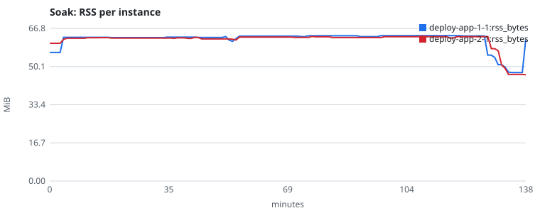
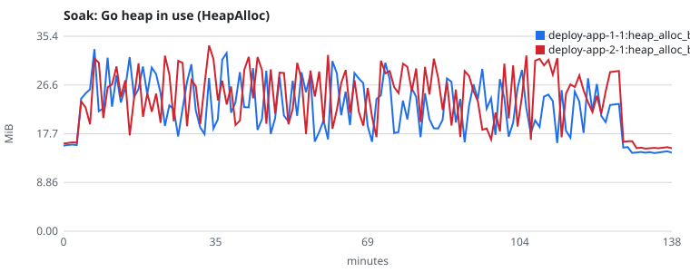
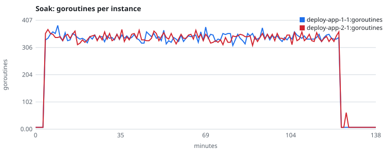
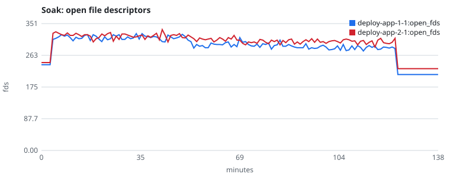
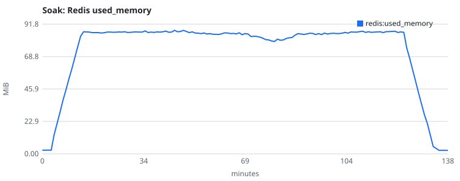
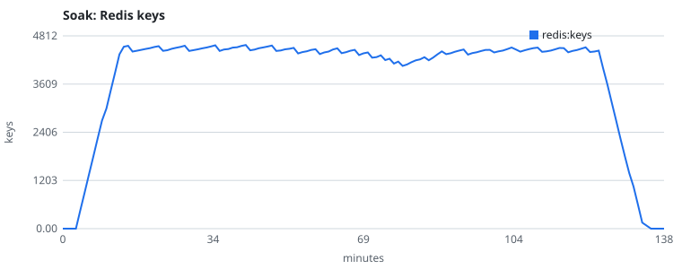

# Stress campaign — Rebound v0.1.0

Load, endurance, spike, reconnection, fault and slow-client tests of Rebound v0.1.0 on the
`examples/deploy/` stack (Redis, two instances of `examples/chat`, nginx round-robin). Every figure below
comes from a file in [`raw/`](raw), written by the command named
next to it. Nothing in the library, the spec, the public API or the Store contract was changed.

<!-- summary:start -->
## Summary

Machine: one laptop (AMD Ryzen 5 4600H, 6 cores / 12 threads, 15.4 GB RAM, Windows 10, Docker
Desktop with a 12-CPU, 7.45 GiB VM) running Redis 7.4, two instances and nginx 1.28 on CPUs 0–7 and
the load generator on CPUs 8–11. No defect of the library was found; the failures are deployment
settings of `examples/deploy/` (§10).

| test | criteria | result | pass |
|---|---|---|---|
| 1. Load ramp (§4) | zero gaps, zero duplicates, exactly one terminal per stream below the knee | **knee at 150 streams in flight** (1–3 readers each, 20 events/s per stream; about 5 300 events/s delivered), reproduced in two runs; Redis at one full core is the limit; integrity clean at every step up to 300 streams; one instance on the memory store: knee at 1 000 streams. With `examples/deploy/nginx.conf` as shipped, nginx's 512 connections are the knee (150 streams) | PASS |
| 2. Soak, 2 h, 75 streams, 30 % of connections dropped (§5) | no upward trend after warm-up, goroutines and Redis keys back to baseline, zero gaps or duplicates | 25 275 streams, 21 178 drops resumed, 0 violations; Go heap, goroutines, fds, Redis flat; RSS +0.3 %/h in the second hour (R² ≈ 0.1); goroutines 7 → 7, Redis keys 0 → 0 | PASS |
| 3. Spike, idle → 375 streams in 10 s → 75 (§6) | no crash, no lost stream, recovery to the baseline p99 | no crash, restart or lost stream; windowed p99 back inside the baseline band **35 s** after the spike | PASS |
| 4. Reconnection storm, 2 runs + timed variant (§7) | zero gaps or duplicates, producer never restarted or moved; `X-Upstream` per resume | 95 757, 120 009 and 138 788 connections (about 1 000 and 2 300 resumes per reader), 49.9 % served by the instance not running the producer; 0 gaps, duplicates, moves or restarts | PASS |
| 5a. Redis down 2 s (§8.1) | retries without duplicates; exactly one terminal; prefix of the log | paused: PASS; restarted with AOF: PASS (appends retried, no duplicate); restarted as shipped (no persistence): the 75 streams in flight are lost, readers get 404 — documented behaviour, deployment finding | PASS / FAIL (expected) |
| 5b. `docker kill` app-1 (§8.2) | `producer_lost` after StaleAfter; exactly one terminal | 39 streams `producer_lost` 15.5–20.5 s after the kill, all others `done`; 0 violations | PASS |
| 5c. `docker stop` app-2 (§8.3) | `server_shutdown` or completion within the grace; exactly one terminal | `done` within the grace; `server_shutdown` at 30.0 s for 37 streams that needed longer; `producer_lost` when Docker's default 10 s kills first; 0 violations | PASS |
| 6. Slow clients (§9) | released by the per-write deadline; other streams unaffected | 6 of 6 released by `httpx: write timeout` and resumed without loss in each run; other streams on par with the heavy control (p99 96.5 vs 84.9 ms); one unexplained 2.9 s stall in one of three runs | PASS |
| Tool verification (§3) | each checker can fail | gap, duplicate, missing terminal, differing terminals, moved, restarted, bad payload, not a prefix: each reported by the checker against a faulty fake server | PASS |

Deployment findings, none applied (`examples/deploy/` is not changed by this campaign): nginx's
`events {}` caps the stack at about 100 streams; nginx has no `proxy_connect_timeout`, so a killed
instance holds requests for tens of seconds; `docker-compose.yml` has no `stop_grace_period`, so
Docker's 10 s cuts the example's 30 s drain; Redis runs without persistence.
<!-- summary:end -->

## 1. Environment

One laptop runs everything: the stack and the load generator share the machine, which is the
main limit of these numbers (§11). From [`environment.txt`](raw/environment.txt):

| | |
|---|---|
| CPU | AMD Ryzen 5 4600H, 6 cores / 12 threads |
| RAM | 15.4 GB (host); the Docker VM gets 7.45 GiB |
| OS | Windows 10 Pro 10.0.19045, Docker Desktop 4.47 (engine 28.4.0, Compose 2.39.4), WSL2 kernel 5.15.153.1 |
| Docker VM | 12 CPUs, 7 997 685 760 bytes |
| Go | 1.26.0 (host, harness build), 1.26.9 (images and `-race` tests) |
| Redis | 7.4.8 (`redis:7-alpine`), no persistence, as in `examples/deploy/` |
| nginx | 1.28.3 (`nginx:1.28-alpine`) |
| Rebound | `rebound-chat:dev` built from this branch (the library is v0.1.0 unchanged) |

CPU pinning ([`scripts/stress/compose.yml`](../../../scripts/stress/compose.yml)): Redis, both instances
and nginx on CPUs 0–7; the load generator on CPUs 8–11. Host port 8080 is held by another service
on this machine, so the overlay publishes nginx on 127.0.0.1:18080; the generator reaches nginx on
the compose network. Everything binds to 127.0.0.1; `CONFORMANCE=1` as in `examples/deploy/`.

**Timers.** Before every run `internal/timercheck -v` measures ten 10 ms timers in the VM (kept as
`NAME.timer`); the harness measures them again at its start and end (`timer_10ms_*` in each
report). A result measured on a VM whose timer took over 20 ms would be invalid; none did.
`timercheck` measured 10.27–10.44 ms before every run except the soak (16.6 ms, under the limit);
the harness measured 10.29–10.54 ms at the start and at the end of every run.

## 2. Method

**Harness.** [`cmd/rebound-load`](../../../cmd/rebound-load) on [`internal/loadtest`](../../../internal/loadtest),
standard library only, run in a container on the compose network by
[`scripts/stress/run.sh`](../../../scripts/stress/run.sh) (`make load`, `make soak`, …; none of them is
part of `make check`). It is built **without `-race`: these runs are throughput measurements.**
Its unit tests, like every Go test of the repository, run with `-race` in `make check`.

**Producer.** With `CONFORMANCE=1` the example also mounts `POST /loadtest/streams`
(`internal/loadtest/producer.go`). Its producer writes `events` data events `delay_ms` apart; each
payload carries its seq, the Unix time in ns just before the write, the instance and a random
nonce of the producer run. The conformance producer cannot be used for this: its payloads carry no
time. Unless stated, a stream is 400 events 50 ms apart (20 s, 20 events/s — a fast LLM).

**Load model.** A phase `NxR@T` keeps N streams in flight for T (closed loop: a finished stream is
replaced at once), each read by R readers (`1-3`: uniformly 1, 2 or 3). `~10s` ramps to N.

**Measures.** *Time to first event* (TTFE): from sending the start request to a reader's first
event, split into *start* (POST → 201) and *connect* (GET → headers). *Event latency*: receive time
minus the payload's write time, for events written while the connection was open (both clocks are
the VM's). *Events/s*: events received by all readers. Percentiles come from a log-linear histogram
whose buckets are at most 1/64 above the true value. Container CPU and memory (`docker stats`),
Redis `INFO` and `DBSIZE` are sampled on the host; goroutines, RSS, open fds and Go heap on each
instance's opt-in `DEBUG_ADDR=127.0.0.1:6060` (expvar), from a container sharing its network
namespace.

**Checks, on every event of every reader.** Seqs dense and increasing across reconnections (gap,
duplicate), exactly one terminal event, nothing after it, the payload's seq equal to the event's,
one instance and one producer run per stream (the producer neither moved nor restarted), all
readers of a stream agreeing on the terminal; for audited streams (a share, or all), a fresh read
from seq 0 after the readers finished, compared byte for byte: what each reader received must be a
prefix of the log.

## 3. Verifying the tools

A checker that cannot fail proves nothing. `internal/loadtest/fake_test.go` runs the harness
against a fake server that breaks one guarantee at a time, and asserts the report names it
(`go test -race ./internal/loadtest`, part of `make check`):

| Injected fault | Reported as |
|---|---|
| seq 3 skipped | `gap`, `incomplete_done` |
| on resume, the last event sent again | `duplicate` |
| body ends without terminal, then 204 | `missing_terminal` |
| reader 1 gets `done`, reader 2 `error` | `terminal_differs` |
| second half written by another instance | `moved` |
| second half from another producer run | `restarted` |
| payload names seq 7 for seq 2 | `bad_payload` |
| the audit read sees other bytes | `not_prefix` |
| stream that never ends | `deadline` ending, `missing_terminal` |

The same harness reports nothing against a clean fake server with drops, nor against the real Hub
(memory store) with readers dropping every 1–3 events and every stream audited
(`TestRun_RealHub`), nor in the slow-reader test on the real Hub
(`TestRun_SlowReaderIsReleasedAndResumes`). `cmd/rebound-load` exits 1 on a server that loses an
event (`TestRun_FailureExitsOne`).

## 4. Test 1 — Load ramp and the knee

**Measures** how far the stack scales: TTFE, event latency, events/s, HTTP errors, CPU and memory
per container, Redis ops/s and clients, per step. **Pass:** zero gaps, zero duplicates, exactly
one terminal per stream at every step below the knee. **Knee:** the first step where delivered
events/s fall below 95 % of the ideal (streams × 20 events/s × readers per stream), p99 event
latency at least triples from the previous step, or any HTTP error or integrity violation
appears ([`knee.py`](knee.py) → [`knee.txt`](raw/knee.txt)).

**Commands:** `make load NAME=…` (`scripts/stress/run.sh ramp`: phases
`50x1-3@3m,200x1-3@3m,500x1-3@3m,1000x1-3@3m,2000x1-3@3m`, 5 % of streams audited);
`PHASES=50x1-3@3m,100x1-3@3m,150x1-3@3m,200x1-3@3m,300x1-3@3m` for the fine ramps;
`make load-baseline` for one instance on the memory store. Per-step resources:
`rebound-load steps` → `NAME.steps.md`.

### 4.1 nginx as shipped: the proxy is the knee

[`ramp-1`](raw/ramp-1.txt) used `examples/deploy/nginx.conf` unchanged. Its `events {}`
means one worker process with 512 connections, and a proxied request holds two (client and
upstream). From the 200-stream step nginx logged `512 worker_connections are not enough`
1 377 661 times ([`ramp-1.logs.txt`](raw/ramp-1.logs.txt)); clients saw transport
errors (976 409 at 2000 streams), TTFE p99 reached 137 s and readers that never got through hit
their deadline. Neither instance logged a warning or an error. Every failed stream still within
Retention when checked (20 of 40) was `done` at seq 401 in Redis
([`ramp-1.failed-in-redis.txt`](raw/ramp-1.failed-in-redis.txt)): the library
finished them; nginx refused the readers. The fine ramp
[`ramp-shipped-fine-1`](raw/ramp-shipped-fine-1.txt) places this knee at **150
streams** (10 379 transport errors, TTFE p99 52 s); readers retried until they got through, so
every stream still ended with exactly one terminal.

| step (as shipped) | delivered ev/s | efficiency | lat p99 ms | TTFE p99 ms | HTTP errors | integrity | pass |
|---|---|---|---|---|---|---|---|
| 50x1-3 | 1 908 | 97 % | 22.0 | 255.9 | 0 | 0 | PASS |
| 100x1-3 | 3 887 | 96 % | 65.5 | 207.6 | 0 | 0 | PASS |
| **150x1-3** | 4 867 | 81 % | 129.0 | 52 076.5 | 10 379 | 0 | knee |
| 200x1-3 (ramp-1) | 4 720 | 59 % | 199.2 | 88 046.8 | 28 916 | 56 missing terminals | FAIL |

**Finding (deployment, not library):** `examples/deploy/nginx.conf` caps the demo stack at about 100
concurrent streams. Raising `worker_processes` and `worker_connections` is enough
([`scripts/stress/nginx-tuned.conf`](../../../scripts/stress/nginx-tuned.conf)). `examples/deploy/` is not
changed by this campaign.

### 4.2 nginx limits raised: the knee of Rebound on Redis

All other runs use `NGINX=tuned`: `worker_processes auto` (8 workers), `worker_connections 65536`;
the `http` block is the one of `examples/deploy/nginx.conf`, unchanged. Two fine ramps, same phases,
different seeds ([`ramp-fine-1`](raw/ramp-fine-1.txt),
[`ramp-fine-2`](raw/ramp-fine-2.txt)):

| step | run | delivered ev/s | efficiency | TTFE p50 / p99 ms | lat p50 / p95 / p99 ms | HTTP errors | gaps / dups / one terminal | pass |
|---|---|---|---|---|---|---|---|---|
| 50x1-3 | 1 | 1 951 | 96 % | 11.1 / 133.2 | 2.3 / 8.3 / 32.0 | 0 | 0 / 0 / 450 of 450 | PASS |
| | 2 | 1 924 | 97 % | 9.3 / 105.9 | 2.3 / 5.8 / 34.1 | 0 | 0 / 0 / 450 of 450 | PASS |
| 100x1-3 | 1 | 3 786 | 95 % | 10.7 / 124.8 | 2.4 / 12.3 / 70.3 | 0 | 0 / 0 / 900 of 900 | PASS |
| | 2 | 3 698 | 95 % | 11.5 / 45.1 | 2.3 / 9.6 / 66.6 | 0 | 0 / 0 / 900 of 900 | PASS |
| **150x1-3** | 1 | 5 323 | 90 % | 27.8 / 94.4 | 6.1 / 123.7 / 209.7 | 0 | 0 / 0 / 1250 of 1250 | knee |
| | 2 | 5 345 | 90 % | 33.6 / 180.4 | 6.1 / 131.1 / 209.7 | 0 | 0 / 0 / 1250 of 1250 | knee |
| 200x1-3 | 1 | 6 392 | 79 % | 61.3 / 140.5 | 22.3 / 207.6 / 241.2 | 0 | 0 / 0 / 1450 of 1450 | PASS |
| | 2 | 6 313 | 80 % | 58.2 / 289.4 | 21.0 / 199.2 / 239.1 | 0 | 0 / 0 / 1450 of 1450 | PASS |
| 300x1-3 | 1 | 6 730 | 56 % | 138.4 / 377.5 | 63.4 / 180.4 / 293.6 | 0 | 0 / 0 / 1630 of 1630 | PASS |
| | 2 | 6 802 | 56 % | 138.4 / 373.3 | 63.4 / 178.3 / 289.4 | 0 | 0 / 0 / 1650 of 1650 | PASS |

**The knee is 150 streams in flight (about 300 readers), in both runs**: delivery falls to 90 % of
the offered rate and p99 event latency triples (70 → 210 ms). The two runs agree within 2.3 % on
events/s at every step and within 6.6 % on p99 latency. Below the knee — and at every step up to
300 — there was no HTTP error, no gap, no duplicate, every stream had exactly one terminal, and
every audited stream (543 in the two runs) was byte-identical to the log.

**What saturates is Redis.** Per-step means of run 1
([`ramp-fine-1.steps.md`](raw/ramp-fine-1.steps.md); run 2 in
[`ramp-fine-2.steps.md`](raw/ramp-fine-2.steps.md) is within a few percent):

| step | app-1 / app-2 CPU % | Redis CPU % | nginx CPU % | Redis ops/s | Redis clients | goroutines per instance |
|---|---|---|---|---|---|---|
| 50x1-3 | 58 / 59 | 58 | 22 | 33 076 | 513 | 241–253 |
| 100x1-3 | 103 / 101 | 94 | 38 | 64 809 | 513 | 469–472 |
| 150x1-3 | 114 / 112 | 103 | 48 | 88 287 | 513 | 697 |
| 200x1-3 | 117 / 116 | 103 | 50 | 100 546 | 514 | 934–940 |
| 300x1-3 | 122 / 121 | 99 | 56 | 102 519 | 513 | 1 375–1 384 |

CPU is per core (100 % = one core). Redis, single-threaded, sits at one full core from 150 streams
on, while each instance uses about 1.1 of its 8 cores, and Redis ops/s stop growing between 200 and
300 streams. In the TTFE split of run 2, start (POST → 201) and connect (GET → headers) grow with
the load (start p50 2.8 → 37 ms, connect p50 4.4 → 67 ms from 50 to 300 streams): both wait on
Redis. TTFE p99 of the first step (105.9–331.4 ms across the ramps, also on the memory store) come
from the first seconds of a run, when 50 streams start at once on cold connections.

Beyond the knee, the coarse ramp [`ramp-tuned-1`](raw/ramp-tuned-1.txt) shows
graceful saturation, not failure: still no HTTP error at 500, 1000 or 2000 streams; delivery stuck
at 6–8 k events/s; p99 latency 0.6–1.6 s. At 1000 and 2000 streams appends slow down until a
400-event stream lasts longer than the readers' deadline (20 s + 2 min of slack): 586 and 5 899
readers gave up mid-stream (`missing_terminal` in that report). Every one of those streams still
within Retention when checked (20) was `done` at seq 401 in Redis: the readers stopped waiting,
the streams were complete. (The reader of that run reported these endings as `read_error`; it now
says `deadline`.)

### 4.3 Baseline: one instance on the memory store

[`baseline-1`](raw/baseline-1.txt): the same coarse ramp against one instance with
`REBOUND_STORE=memory`, no nginx, the deploy stack stopped
([`baseline-1.steps.md`](raw/baseline-1.steps.md)).

| step | delivered ev/s | efficiency | lat p50 / p99 ms | TTFE p99 ms | CPU % | memory MiB | integrity | pass |
|---|---|---|---|---|---|---|---|---|
| 50x1-3 | 2 028 | 99 % | 0.5 / 1.6 | 207.6 | 18 | 69 | 0 | PASS |
| 200x1-3 | 7 897 | 99 % | 0.5 / 2.3 | 201.3 | 68 | 305 | 0 | PASS |
| 500x1-3 | 19 738 | 98 % | 0.6 / 8.5 | 211.8 | 193 | 850 | 0 | PASS |
| **1000x1-3** | 37 169 | 93 % | 1.1 / 65.5 | 255.9 | 426 | 1 898 | 0 | knee |
| 2000x1-3 | 39 868 | 50 % | 15.3 / 5 972.7 | 1 375.7 | 658 | 3 121 | 0 | PASS (saturated) |

One instance on memory goes about 6× further than two instances on one Redis (knee 1000 vs 150
streams). Its memory grows with the load because the memory store keeps every event for Retention
(10 min): about 3 GiB at 2000 streams of 400 events. No integrity violation at any step.

## 5. Test 2 — Soak

**Measures** whether two hours of load leave anything behind. **Pass:** no upward trend after
warm-up (slope fitted and reported), goroutines back to the idle baseline at the end, Redis keys
back to the baseline once Retention has expired, zero gaps or duplicates.

**Command:** `STREAMS=75 NGINX=tuned make soak NAME=soak-1` — 75 streams in flight (half the knee),
1–3 readers each, for 2 h; each connection is dropped with probability 0.3 at a random point and
the reader resumes at once with `Last-Event-ID`; 2 % of streams audited. Samples every minute from
3 minutes before the load to 15 minutes after it (Retention is 10 minutes). Redis was empty at the
start (`DBSIZE` 0). Timer: `timercheck` 16.6 ms before the run (the worst of the campaign, under
the 20 ms limit), 10.36 ms in the harness at its start and at its end.

| criterion | result | pass |
|---|---|---|
| gaps / duplicates / bad payloads | 0 / 0 / 0 over 25 275 streams, 50 320 readers, 71 498 connections | PASS |
| exactly one terminal per stream | 25 275 `done`, no stream unfinished, no reader without terminal | PASS |
| audited streams identical to the log | 555 of 555 | PASS |
| drops resumed | 21 178 connections dropped (29.6 %), every one resumed without loss | PASS |
| HTTP errors, app warnings or errors, nginx errors | 0, 0, 0 | PASS |
| upward trend after warm-up | see the fit below: Go heap, goroutines, fds and Redis flat or falling; RSS +0.3 %/h in the second hour | PASS |
| goroutines back to baseline | 7 and 7 before the load → 7 and 7 15 minutes after it | PASS |
| Redis keys back to baseline | 0 before → 0 at most 11.6 minutes after the last stream ended (Retention 10 minutes); `used_memory` 2.71 MB → 2.61 MB | PASS |

[`soak-1.txt`](raw/soak-1.txt): 2 792 events/s delivered; event latency p50 / p95 /
p99 2.7 / 27.0 / 80.7 ms (max 1.73 s); TTFE 9.4 / 62.4 / 172.0 ms; events replayed on resume
(written before the reconnection) arrived 6.9 / 51.9 / 142.6 ms after they were written. Streams
were produced 12 722 times by app-1 and 12 553 times by app-2; their readers were served by both
upstreams (`served_by_upstream` in [`soak-1.json`](raw/soak-1.json)).

**Trends.** Least-squares fit over the load after a 20-minute warm-up (minutes 23 to 123, 100
samples per series; [`soak-1.trend.txt`](raw/soak-1.trend.txt)):

| series | mean | min – max | slope per hour | slope, % of mean per hour | R² |
|---|---|---|---|---|---|
| app-1 RSS | 63.2 MiB | 61.1 – 63.6 MiB | +0.61 MiB | +0.97 % | 0.48 |
| app-2 RSS | 62.8 MiB | 61.7 – 63.3 MiB | +0.47 MiB | +0.75 % | 0.45 |
| app-1 Go heap (HeapAlloc) | 23.0 MiB | 16.0 – 32.4 MiB | −1.01 MiB | −4.4 % | 0.01 |
| app-2 Go heap (HeapAlloc) | 25.4 MiB | 16.6 – 33.8 MiB | −0.94 MiB | −3.7 % | 0.01 |
| app-1 goroutines | 343 | 313 – 382 | +0.8 | +0.2 % | 0.00 |
| app-2 goroutines | 343 | 313 – 373 | −3.5 | −1.0 % | 0.02 |
| app-1 open fds | 295 | 275 – 323 | −21.9 | −7.4 % | 0.67 |
| app-2 open fds | 306 | 286 – 334 | −12.9 | −4.2 % | 0.48 |
| Redis `used_memory` | 85.1 MiB | 79.5 – 87.4 MiB | −0.48 MiB | −0.6 % | 0.02 |
| Redis keys | 4 421 | 4 062 – 4 583 | −49 | −1.1 % | 0.05 |

The Go heap, goroutines, fds and Redis show no upward trend. RSS rises by under 1 MiB over the
100 minutes: it climbs in the first hour while the runtime's heap reaches its working size and
then flattens. Over the second hour alone
([`soak-1.trend-2nd-hour.txt`](raw/soak-1.trend-2nd-hour.txt)) both instances grow
by +0.19 MiB/h (+0.30 %/h, R² 0.10–0.14) while their heap in use falls. With R² that low this is
noise around a plateau, not a leak; a leak would also show in the heap. Redis keys stay flat at
about 4 400: Retention (10 min) bounds them, and they fall to 0 once the load stops.

Samples every 10 minutes ([`soak-1.table.txt`](raw/soak-1.table.txt); minute 0 is
the idle baseline, the load runs from minute 3 to 123):

| min | app-1 / app-2 RSS MiB | app-1 / app-2 heap MiB | app-1 / app-2 goroutines | app-1 / app-2 fds | Redis MiB | Redis keys |
|---|---|---|---|---|---|---|
| 0 | 56.2 / 60.3 | 15.6 / 15.9 | 7 / 7 | 237 / 243 | 2.6 | 0 |
| 10 | 62.9 / 62.5 | 31.5 / 20.6 | 343 / 343 | 312 / 325 | 52.8 | 2700 |
| 20 | 62.7 / 62.5 | 29.8 / 25.1 | 334 / 334 | 308 / 309 | 85.8 | 4486 |
| 30 | 62.7 / 62.5 | 22.0 / 27.5 | 340 / 337 | 314 / 322 | 85.9 | 4437 |
| 40 | 63.0 / 62.6 | 28.9 / 19.3 | 354 / 355 | 314 / 318 | 86.3 | 4519 |
| 50 | 62.8 / 62.2 | 21.0 / 28.8 | 346 / 358 | 315 / 312 | 86.6 | 4437 |
| 60 | 63.4 / 63.0 | 16.7 / 19.7 | 328 / 355 | 294 / 310 | 84.6 | 4358 |
| 70 | 63.4 / 63.0 | 16.3 / 26.0 | 340 / 355 | 299 / 305 | 85.1 | 4376 |
| 80 | 63.6 / 63.1 | 24.4 / 25.5 | 313 / 325 | 280 / 295 | 79.5 | 4099 |
| 90 | 63.2 / 62.8 | 24.1 / 25.8 | 337 / 346 | 284 / 300 | 84.5 | 4379 |
| 100 | 63.6 / 63.1 | 24.2 / 18.2 | 328 / 340 | 278 / 296 | 85.4 | 4399 |
| 110 | 63.6 / 63.1 | 24.8 / 30.1 | 337 / 331 | 290 / 303 | 86.8 | 4520 |
| 120 | 63.5 / 63.1 | 21.8 / 23.4 | 340 / 328 | 285 / 298 | 86.7 | 4493 |
| 130 | 50.9 / 57.9 | 14.3 / 16.4 | 7 / 7 | 210 / 226 | 35.4 | 1810 |
| 138 | 61.8 / 46.5 | 14.3 / 15.1 | 7 / 7 | 210 / 226 | 2.5 | 0 |

Minute 0 of app-2 and Redis is the first sample of their files: `analyze -table-every` takes the
last sample at or before each offset, and theirs were taken 0.6–0.9 s after app-1's. One Redis
sample is missing (22:25:29, a failed `redis-cli INFO`, [`soak-1.host.err`](raw/soak-1.host.err)).
The last stream ended at 22:14:55; Redis held 150 keys at 22:24:29 and 0 at 22:26:29.

Charts: `rebound-load chart -in soak-1.*.csv -series … -out docs/benchmarks/v0.1.0/soak-*.svg`. The
x axis is minutes since the first sample; the load runs from minute 3 to minute 123.

**Verdict: PASS.**

## 6. Test 3 — Spike

**Measures** a sudden burst from idle. **Pass:** no crash, no lost stream, and recovery to the
baseline p99, the time to which is reported.

**Command:** `STREAMS=75 NGINX=tuned make spike NAME=spike-1`: phases
`75x1-3@3m,0x1@1m,375x1-3~10s@2m,75x1-3@5m` — the soak load for 3 minutes (baseline), idle for
a minute, 5× the soak load (375 streams, above the knee) reached in 10 s and held 2 minutes, then
back to the soak load for 5 minutes; 5 s windows; 5 % of streams audited. Timer 10.35 ms
(`timercheck`), 10.43 / 10.36 ms in the harness.

| phase | streams | readers | ev/s | TTFE p50 / p99 ms | lat p50 / p95 / p99 ms | HTTP errors | integrity | terminals | pass |
|---|---|---|---|---|---|---|---|---|---|
| 75x1-3@3m (baseline) | 675 | 1 366 | 2 820 | 22.8 / 302.0 | 3.3 / 28.3 / 77.6 | 0 | 0 | 675 `done` | PASS |
| 0x1@1m (idle) | 0 | 0 | – | – | – | 0 | 0 | – | PASS |
| 375x1-3~10s@2m (spike) | 1 125 | 2 258 | 5 694 | 253.8 / 671.1 | 134.2 / 310.4 / 465.6 | 0 | 0 | 1 125 `done` | PASS |
| 75x1-3@5m (after) | 975 | 1 968 | 3 102 | 11.7 / 390.1 | 3.9 / 169.9 / 281.0 | 0 | 0 | 975 `done` | PASS |

([`spike-1.txt`](raw/spike-1.txt); the "after" phase includes the last 30 s of the
spike's streams, which finish after the target has dropped.) No container restarted (all up since
before the soak, [`containers-after-spike.txt`](raw/containers-after-spike.txt)), no
instance logged a warning or an error, nginx logged nothing, no stream was unfinished, and all 136 audited streams
matched the log. During the spike Redis is at one full core again (104 %) and each instance holds
about 1 710 goroutines; 35 s after the spike phase ends they are back at 330–360, the level of the
baseline phase ([`spike-1.steps.md`](raw/spike-1.steps.md), samples every 5 s in
`spike-1.deploy-app-*.csv`).

**Recovery** ([`spike.py`](spike.py) →
[`spike-1.recovery.txt`](raw/spike-1.recovery.txt)). The 5 s windowed p99 is noisy: it
alternates between low and high windows in the baseline phase too, where 14 of 36 windows are above
the phase's own p99 (77.6 ms) and the windowed p99 ranges over 24.4–138.4 ms.

| recovery measure | result |
|---|---|
| windowed p99 back inside the baseline band (≤ 138.4 ms) and staying there | from the window ending 35 s after the spike phase ended |
| windowed p99 at or under the baseline phase p99 (77.6 ms) and staying there | from the window ending 295 s after the spike phase ended |

The first measure is the one that compares like with like: 35 s is the time for the spike's last
streams (20 s each, the last ones started as the phase ended) to finish; the window ending at 405 s
is the first with 75 streams in flight again, and every later window is inside the baseline band
(12.2–136.3 ms). The second, stricter measure is dominated by the noise of single windows, which
crosses 77.6 ms in the baseline itself.

**Verdict: PASS** — no crash, no lost or unfinished stream, no integrity violation; latency back
to the baseline band 35 s after the spike.

## 7. Test 4 — Reconnection storm

**Measures** resumes at a rate no real client reaches. **Pass:** zero gaps or duplicates, and the
producer never restarted or moved; `X-Upstream` of every resume reported with its distribution.

**Command:** `NGINX=tuned make storm NAME=…` (`scripts/stress/run.sh storm`): 20 streams in
flight for 1 minute, 3 readers each; a stream is 3 000 events 10 ms apart (100 events/s); each
connection is cut after 1–5 events (`every:1-5`) or after 5–50 ms (`DROP=ms:5-50`), and the reader
reconnects at once with `Last-Event-ID` through nginx round-robin; every stream audited. The two
`every:1-5` runs are the same test with different seeds. Upstream addresses come from the compose
network ([`storm-1.upstreams.txt`](raw/storm-1.upstreams.txt), identical in the three
runs): 172.20.0.3 is app-1, 172.20.0.4 is app-2.

| | [storm-1](raw/storm-1.txt) | [storm-2](raw/storm-2.txt) | [storm-ms-1](raw/storm-ms-1.txt) |
|---|---|---|---|
| drops | every 1–5 events | every 1–5 events | every 5–50 ms |
| timer (timercheck; harness start / end) | 10.34; 10.35 / 10.37 ms | 10.33; 10.45 / 10.35 ms | 10.44; 10.35 / 10.33 ms |
| streams (producer on app-1 / app-2) | 32 (16 / 16) | 40 (14 / 26) | 20 (9 / 11) |
| readers | 96 | 120 | 60 |
| connections (resumes per reader) | 95 757 (996) | 120 009 (999) | 138 788 (2 312) |
| events received (= streams × 3 000 × 3) | 288 000 | 360 000 | 180 000 |
| connect p50 / p99 ms | 17.6 / 76.5 | 18.1 / 78.6 | 20.2 / 45.6 |
| live event latency p50 / p99 ms | 13.9 / 68.2 | 16.0 / 68.2 | 16.3 / 40.9 |
| replayed event latency p50 / p99 ms | 46.7 / 245.4 | 41.4 / 255.9 | 71.3 / 1 090.5 |
| responses by upstream, app-1 / app-2 | 47 880 / 47 877 | 60 007 / 60 002 | 32 951 / 33 058 |
| responses from the instance not running the producer | 47 766 (49.9 %) | 59 930 (49.9 %) | 32 970 (49.9 %) |
| gaps / duplicates / moved / restarted | 0 / 0 / 0 / 0 | 0 / 0 / 0 / 0 | 0 / 0 / 0 / 0 |
| exactly one terminal per stream | 32 `done` | 40 `done` | 20 `done` |
| audited streams identical to the log | 32 of 32 | 40 of 40 | 20 of 20 |
| HTTP errors, app warnings or errors, nginx errors | 0, 0, 0 | 0, 0, 0 | 0, 0, 0 |
| **pass** | **PASS** | **PASS** | **PASS** |

`X-Upstream` is recorded on every response (`served_by_upstream` in each JSON report, by producer
instance and upstream). nginx alternates upstreams, so every resume lands on the other instance
half of the time; each such resume reads the stream from Redis while the producer keeps running
on the first instance, which is the case G4 covers. In `ms:5-50`, 72 779 of the 138 788
connections were cut before their response headers arrived (connect p50 is 20 ms), so they carry
no upstream; the 66 009 that did split 49.9 / 50.1. Replayed events wait longer there (p99 1.1 s)
because a reader can lose several connections in a row before one reaches the body.

In every connection, the producer instance and the producer run (the nonce in each payload) were
those of the stream's first event: no producer moved or restarted, whichever instance served the
resume.

**Verdict: PASS**, in both runs of the same test and in the timed variant.

## 8. Test 5 — Faults under load

**Pass:** every stream ends with exactly one terminal, and what each reader received is a prefix
of what was written; the expected behaviour of each fault comes from the spec. **Load:** the soak
load, `75x1-3@4m`; a stream is 600 events 50 ms apart (30 s); every stream audited; the fault is
injected 60 s after the run's start by `scripts/stress/run.sh` (`fault()`), which logs each step
with its time (`NAME.fault.log`). The WARN/ERROR lines of both instances during each run, by
message, are in `NAME.app-warnings.txt`.

### 8.1 Redis down for 2 s

**Spec.** The `Writer` "retries transient store errors for at most `StaleAfter / 2`" (7.5 s) and
each event is stored exactly once (§3.1, ADR 0005); readers get 503 before headers or a closed
connection after them, and retry (failure table of docs/03-architecture.md). The store contract assumes the log
survives for `Retention`; `examples/deploy/` runs Redis without persistence, and docs/how-it-works.md
already says that "a Redis without persistence that restarts loses in-flight streams, and clients
get a `404`". Three runs separate the two cases:

| | [pause](raw/fault-redis-pause-1.txt) | [restart, as shipped](raw/fault-redis-1.txt) | [restart, AOF](raw/fault-redis-aof-1.txt) |
|---|---|---|---|
| fault | `docker pause` for 2.4 s: no reply, data kept | `docker stop -t 1`, 2 s, `docker start`: down about 3.5 s, no persistence | the same, Redis with `appendonly yes`, `appendfsync always` (`REDIS=aof`, [`redis-aof.yml`](../../../scripts/stress/redis-aof.yml)) |
| `make` / command | `run.sh fault-redis-pause` | `make faults` → `run.sh fault-redis` | `REDIS=aof` + `run.sh fault-redis` |
| timer | 10.36 ms | 10.36 ms | 10.35 ms |
| streams / readers / connections | 600 / 1 203 / 1 203 | 600 / 1 196 / 1 347 | 525 / 1 055 / 1 208 |
| streams lost with Redis | – | 75 (all those in flight) | 0 |
| terminals | 600 `done` | 525 `done`, 75 none | 525 `done` |
| readers' events: gaps / duplicates / moved / restarted | 0 / 0 / 0 / 0 | 0 / 0 / 0 / 0 | 0 / 0 / 0 / 0 |
| audited streams identical to the log | 600 of 600 | 525 of 525; 75 not auditable (gone) | 525 of 525 |
| HTTP errors | 0 | 151 × `GET 404` (final) | 15 × `GET 503` (retried) |
| connection endings other than the terminal | 0 | 151 server EOF, then the 404 | 138 server EOF and 15 503s, each followed by a resume |
| event latency p99 / max | 94.4 ms / 2.39 s | 56.1 ms / 0.23 s | 86.0 ms / 4.78 s |
| app warnings | none | 151 `stream read failed`, 138 `stream vanished while running` (75 streams) | 138 `stream read failed`, 58 `heartbeat touch`, 49 `store append failed; retrying`, 15 `store unavailable` |
| **pass** | **PASS** | **FAIL (expected, documented)** | **PASS** |

- **Pause** (Redis alive but silent): appends wait, then complete; event latency peaks at 2.39 s
  in the window of the pause and is back under 40 ms in the next one
  ([`fault-redis-pause-1.json`](raw/fault-redis-pause-1.json), windows 55–65 s).
  Nothing is logged: the commands block instead of failing.
- **Restart without persistence**: Redis comes back empty. The next heartbeat of each running
  producer finds its stream gone and cancels it (`stream vanished while running`, logged once or
  twice per stream, 22:56:13.3–14.3, 1.0–2.0 s after `docker start` returned); each reader's response is
  closed, its resume gets `404` and it stops — the client cannot be given a terminal for a stream
  that no longer exists. What the 151 readers of those 75 streams received was dense from seq 1,
  from one producer run (no gap, duplicate, move or restart); it cannot be compared with a log
  that is gone. Streams started after the restart completed normally. This is the documented
  consequence of running Redis without persistence, not a defect of the library.
- **Restart with an append-only file**: the streams survive. While Redis is down and then
  `LOADING`, appends are retried (`store append failed; retrying`, `retry_in_ms` from 50) and
  heartbeats fail and retry; readers get 503 or a closed connection and resume with
  `Last-Event-ID`. Every stream ends `done`, every audited log is byte-identical to what readers
  received, and no event was stored twice — the expected-seq retry of ADR 0005 under a real
  outage. `appendfsync always` costs throughput (2 478 vs 2 747 events/s, event latency p50 10.5
  vs 2.4 ms): fewer streams completed in the same 4 minutes.

**Finding (deployment, not library):** with `examples/deploy/`'s Redis (`--save "" --appendonly no`), a
Redis restart loses every stream in flight; clients get a `404` and no terminal. A deployment
that must survive Redis restarts needs persistence (AOF) or a replica.

### 8.2 `docker kill` of app-1 while it generates

**Spec.** G5: "If the process dies: a reader observing the stream writes `producer_lost` after
`StaleAfter` without activity, measured on the reader's own clock"; G7: exactly one terminal is
stored whoever writes it. The process is not resumed (§7, non-goals).

**Command:** `make faults` → `run.sh fault-kill`: `docker kill deploy-app-1-1` (SIGKILL) at
23:06:52.4, `docker start` 60 s later ([`fault-kill-1.fault.log`](raw/fault-kill-1.fault.log)).
Timer 10.35 ms; 10.54 / 10.33 ms in the harness. [`fault-kill-1.txt`](raw/fault-kill-1.txt):

| criterion | result | pass |
|---|---|---|
| exactly one terminal per stream | 585 streams: 546 `done`, 39 `error{producer_lost}` | PASS |
| streams of app-1 in flight at the kill end with `producer_lost` | 39 streams, detected 15.5–20.5 s after the kill (StaleAfter 15 s) | PASS |
| one terminal stored per lost stream (G7) | 44 `producer lost` lines from the readers on app-2 for 39 streams; every reader of a stream saw the same terminal | PASS |
| readers' events: gaps / duplicates / moved / restarted | 0 / 0 / 0 / 0 | PASS |
| audited streams identical to the log | 585 of 585 | PASS |
| HTTP errors | 3 `start` and 4 `GET` transport errors (see below); no 5xx | – |
| app warnings or errors | only the 44 `producer lost` above ([`fault-kill-1.app-warnings.txt`](raw/fault-kill-1.app-warnings.txt)) | PASS |

The 75 connections served by app-1 broke at the kill (`read_error`; nginx: `upstream prematurely
closed connection`) and resumed through nginx on app-2. Readers of streams produced by app-2 went
on without a gap. Readers of streams produced by app-1 received no more events; after 15 s of
silence on their clock they wrote `producer_lost`, which every reader of the stream then
received. The 15.5–20.5 s spread comes from the reconnection: a reader's clock starts with its
connection. Events of those streams written before the kill were all delivered (the audit read
matches what readers got).

**What the kill does to nginx.** nginx keeps a dead upstream in its round-robin, and
`examples/deploy/nginx.conf` sets no `proxy_connect_timeout` (default 60 s)
([`fault-kill-1.nginx-errors.txt`](raw/fault-kill-1.nginx-errors.txt)). Right after
the kill, connects to app-1 were refused at once and nginx passed the requests to app-2. Once the
killed container's address had gone, connects to it hung instead, until the kernel gave up with
`Host is unreachable` (27 GET and 17 POST connects, logged at 23:07:40–49). Requests caught in
those connects waited: 3 starts and 4 GETs reached the harness's 30 s response-header timeout
(the 3 `start` transport errors; the 4 readers reconnected and got the whole stream as a replay,
TTFE 30 s); the others were passed to app-2 when the connect failed, 10–19 s late (connect
latency max 15.8 s, start max 18.8 s, in the windows ending 115–120 s). These are the outliers of
the run (TTFE p99 18.0 s, event latency max 15.8 s for events written while a request was held).
The 3 failed starts were still waiting on a connect to the dead instance when the harness gave up.

**Verdict: PASS** for the library — every stream has exactly one terminal, `producer_lost` after
`StaleAfter` as specified, no gap or duplicate. **Finding (deployment):** without
`proxy_connect_timeout`, a hard-killed instance holds the requests nginx routes to it for tens of
seconds (here more than the client's 30 s for 7 of them); a short connect timeout (1–2 s) bounds it.

### 8.3 `docker stop` of app-2 (graceful)

**Spec.** "`Close(ctx)`: refuses new `Start`s, waits for local producers until `ctx` is done, then
cancels the remaining ones and writes their `server_shutdown` terminals" (§3.1). The example calls
`hub.Close` with 30 s on SIGTERM, then `srv.Shutdown` with 5 s (`examples/chat/main.go`).

**Commands:** `make faults` → `run.sh fault-stop` (`docker stop -t ${GRACE:-40}` at 60 s, `docker
start` when it returns). The closed loop starts its streams in waves, so the time a stream has
left at the signal depends on its length: three runs cover the three outcomes.
A first run with 75 s streams ([`fault-stop-long-1`](raw/fault-stop-long-1.txt))
still ended all 38 app-2 streams `done`, 26.6 s after SIGTERM, inside the grace; it was repeated
with 150 s streams to reach the deadline.

| | [30 s streams, grace 40 s](raw/fault-stop-1.txt) | [150 s streams, grace 40 s](raw/fault-stop-long-2.txt) | [30 s streams, grace 10 s](raw/fault-stop-grace10-1.txt) |
|---|---|---|---|
| command | `run.sh fault-stop` | `FAULT_EVENTS=3000` | `GRACE=10` (Docker's default) |
| timer | 10.31 ms | 10.35 ms | 10.36 ms |
| app-2 streams running at SIGTERM | 38, all with < 30 s left | 37 with more than 30 s left | about 40, with about 10 s left |
| what happened ([`*.shutdown.log`](raw/fault-stop-1.shutdown.log)) | the 38 ended `done` 11.3–11.6 s after SIGTERM; `srv.Shutdown` then waited 5 s for open responses; exit after 16.7 s | `hub closed at deadline`: the 37 were ended with `server_shutdown` 30.0 s after SIGTERM; exit 35.0 s after it | 9 ended `done` at 10.0–10.3 s; SIGKILL at 10 s; the 31 others ended `producer_lost`, written by readers on app-1 15.3–20.3 s after the kill |
| streams / terminals | 600: 600 `done` | 150: 113 `done`, 37 `server_shutdown` | 569: 538 `done`, 31 `producer_lost` |
| exactly one terminal per stream | yes | yes | yes |
| readers' events: gaps / duplicates / moved / restarted | 0 / 0 / 0 / 0 | 0 / 0 / 0 / 0 | 0 / 0 / 0 / 0 |
| audited streams identical to the log | 600 of 600 | 150 of 150 | 569 of 569 |
| starts refused while closing | 6 × `POST 503` | 0 | 4 × `POST 503` |
| connections cut at exit, resumed on app-1 | 1 | 38 | 56 |
| **pass** | **PASS** | **PASS** | **PASS** (G5 via `producer_lost`) |

In every case each stream ends with exactly one terminal, and what each reader received is
identical to the stored log. While it closes, an instance still serves `GET`s (readers on it keep
receiving their streams, including streams produced elsewhere) and answers `POST` with 503; nginx
passes that 503 to the client, which must start again (the harness counts it as a start error and
does not retry). After `hub.Close`, `srv.Shutdown`'s 5 s are not enough for responses still open on
streams produced elsewhere, so the example exits with `chat: shutdown: context deadline exceeded`
(logged at ERROR) and those connections are cut; their readers resume on the other instance
without a gap.

**Finding (deployment):** `examples/deploy/docker-compose.yml` sets no `stop_grace_period`, so `docker stop`
or `docker compose down` gives the example Docker's default 10 s, less than its 30 s hub grace:
streams that need more than 10 s end with `producer_lost` (15 s later) instead of `done` or
`server_shutdown`. A `stop_grace_period` above 35 s (hub grace + HTTP shutdown) lets the shutdown
run as designed.

**Verdict for Test 5: PASS** for the library on every fault, the Redis restart without persistence
excepted, which loses streams as documented (§8.1).

## 9. Test 6 — Slow clients

**Measures** whether a reader that stops reading is released by the per-write deadline of
`httpx` (`WithWriteTimeout`, 10 s by default, spec §4) and whether it slows the other streams.
**Pass:** each slow connection is closed by the server, the slow reader resumes and receives its
whole stream, and the other streams' latency is unaffected.

**Command:** `make slow` (`run.sh slow-control`, `run.sh slow`) with `SLOW_PHASES=75x1-3@4m`: the
soak load, plus 6 slow streams of 1 500 events of 32 KiB, 5 ms apart (48 MiB each, written in
about 8 s), each read by one reader that stops reading after 10 events, waits 60 s, then reads
again (resuming with `Last-Event-ID` if its connection was closed). The control for the volume
these streams add is `SLOW_AFTER=1000000` (the same 6 streams, read without pausing).

| run | normal streams / readers | ev/s | event latency p50 / p95 / p99 / max ms | slow readers released | slow streams | integrity | pass |
|---|---|---|---|---|---|---|---|
| [slow-control-1](raw/slow-control-1.txt) (no large streams) | 900 / 1 787 | 2 859 | 2.3 / 8.9 / 41.9 / 131 | – | – | 0 | PASS |
| [slow-heavy-control-1](raw/slow-heavy-control-1.txt) (large streams, read normally) | 900 / 1 806 | 2 798 | 2.9 / 23.6 / 84.9 / 336 | – | 6 `done`, 6 connections | 0 | PASS |
| [slow-3](raw/slow-3.txt) (large streams, readers paused) | 825 / 1 693 | 2 771 | 4.6 / 38.3 / 96.5 / 321 | 6 of 6 | 6 `done`, 12 connections | 0 | PASS |
| [slow-2](raw/slow-2.txt) (same as slow-3) | 825 / 1 660 | 2 723 | 2.3 / 34.6 / 117.4 / 2 939 | 6 of 6 | 6 `done`, 12 connections | 0 | PASS (see below) |

Timers: `timercheck` 10.33, 10.37, 10.40 and 10.27 ms; harness 10.31–10.43 ms.

- **Release.** In every slow run the app logged `httpx: write timeout; closing the response` for
  each of the 6 slow connections (`slow-*.app-warnings.txt`), 11–15 s after the run started: the
  10 s deadline counts from the first write that blocks, once the socket buffers between the app,
  nginx and the paused reader are full. nginx logged `upstream prematurely closed connection while
  sending to client` for each. After its pause each slow reader reconnected with `Last-Event-ID`,
  received the rest of its 1 500 events and the `done` terminal, with no gap or duplicate
  (2 connections per slow reader, `slow_released` 6).
- **Other streams.** A paused reader holds nothing the other streams need: slow-3 is within 14 %
  of the heavy control on p99 (96.5 vs 84.9 ms) and on par on the maximum (321 vs 336 ms) and on
  events/s (2 771 vs 2 798). What the 6 large streams cost (control → heavy control: p99 41.9 →
  84.9 ms) is Redis absorbing 288 MiB in about 8 s, whether their readers pause or not. The
  pausing readers do add one burst: when they resume at about 70 s they read their 48 MiB backlog
  at once (windowed p99 151 ms in slow-3, against 51 ms in the heavy control at that time,
  [`slow-3.json`](raw/slow-3.json)). The closed loop starts its streams in waves of
  75: 825 against 900 normal streams is 11 against 12 waves in the 4 minutes, so events/s is the
  figure to compare.
- **One unexplained stall in slow-2.** In the window ending 20 s after the start, every stream of
  slow-2 stalled for about 2.9 s (windowed p99 2 919 ms, 756 events/s), with Redis at 131 % CPU and
  418 MB of earlier runs' streams still retained in it. slow-1 (the same test, before the harness
  fix of §10) and slow-3 (the same test on an empty Redis, [`slow-3.redis-before.txt`](raw/slow-3.redis-before.txt))
  show no such stall in that window (windowed p99 60 and 122 ms). It did not recur; its cause was
  not found. No integrity check failed during it.

**Verdict: PASS** — the per-write deadline releases every slow reader, each resumes without loss,
and a paused reader does not slow the others; one stall in one of three runs is reported above.

## 10. What failed, and why

No test revealed a defect in the library: in every run, every reader's events were dense,
ordered and from one producer run, every audited stream was byte-identical to what its readers
received, and no event was stored twice. What failed or degraded has a measured cause outside it:

| what | where | cause | fix (not applied: `examples/deploy/` is out of scope) |
|---|---|---|---|
| transport errors from 150 streams, missing terminals from 200 | Test 1, nginx as shipped (§4.1) | `examples/deploy/nginx.conf` has `events {}`: one worker, 512 connections, two per proxied stream | `worker_processes auto`, `worker_connections` sized for the streams (as in `scripts/stress/nginx-tuned.conf`) |
| delivery under 95 % of the offered rate from 150 streams | Test 1, the knee (§4.2) | Redis at one full core (single-threaded) | more Redis capacity (Cluster with `{id}` hash tags, faster cores); the knee scales with Redis, not with instances |
| readers giving up at 1000–2000 streams | Test 1, beyond the knee (§4.2) | appends slowed by the saturated Redis until a stream outlasts the reader's deadline; the streams were complete | below the knee: none |
| 75 streams lost, readers get 404 | Test 5, Redis restart as shipped (§8.1) | `examples/deploy/` runs Redis without persistence; documented in docs/how-it-works.md | AOF (measured: no loss) or a replica |
| requests delayed by tens of seconds, 3 failed starts | Test 5, `docker kill` (§8.2) | nginx keeps the dead upstream and has no `proxy_connect_timeout` (60 s default) | `proxy_connect_timeout 1s`–`2s` |
| `producer_lost` instead of `done` or `server_shutdown` | Test 5, `docker stop` with Docker's default 10 s (§8.3) | no `stop_grace_period` in `examples/deploy/docker-compose.yml`; the example needs up to 35 s | `stop_grace_period: 40s` |
| starts answered 503 while an instance closes | Test 5, `docker stop` (§8.3) | `Hub.Close` refuses new `Start`s (spec §3.1); nginx forwards the 503 | the client retries the start, or nginx retries it on the other upstream (`proxy_next_upstream http_503 non_idempotent`, safe here because a refused start creates nothing) |
| `chat: shutdown: context deadline exceeded` at ERROR | Test 5, `docker stop` (§8.3) | the example gives `srv.Shutdown` 5 s while readers of streams produced elsewhere stay connected; they resume without a gap | cosmetic; a longer HTTP shutdown or a lower level for this case |

Also found in the harness during the campaign, and fixed before the runs reported here: a reader
that was cut at its deadline was reported as `read_error` (now `deadline`, ramp-tuned-1 predates
it); the slow readers' late events were counted in the latency of the normal streams (slow-1;
slow-2 and later runs keep them out of the windows).

## 11. What could not be tested

- **Redis Cluster or Sentinel failover.** The store supports both through `{id}` hash tags; this
  campaign had one Redis node, so no failover, resharding or replica promotion was exercised.
- **Several machines.** Everything ran on one laptop: the network is a Docker bridge (no real
  latency, loss or partition) and the load generator shares the machine with the stack (CPU sets
  0–7 and 8–11 keep them apart, not the memory bus, the caches or the VM's scheduler). The
  absolute numbers are this laptop's; the knee on a server with a dedicated Redis would be higher.
- **Clock skew.** All instances share the VM's clock; `producer_lost` is measured on the reader's
  own clock by design, but skew between instances was not injected.
- **Redis persistence other than `appendfsync always`**, Redis `maxmemory` and eviction, and a
  network partition between an instance and Redis (`docker pause` of Redis approximates the
  latter from the instance's side).
- **Endurance beyond 2 hours**, `MaxDuration` timeouts and `Cancel` under load.
- **The TypeScript client and browsers under load**: the harness is the Go reader; the client's
  own resume logic is covered by its test suite, not here.
- **TLS, HTTP/2 and proxies other than nginx.**
