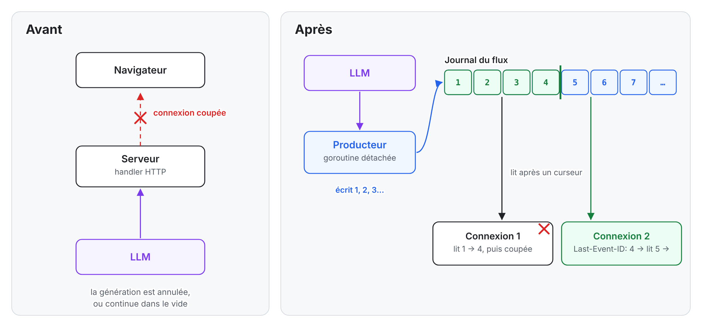
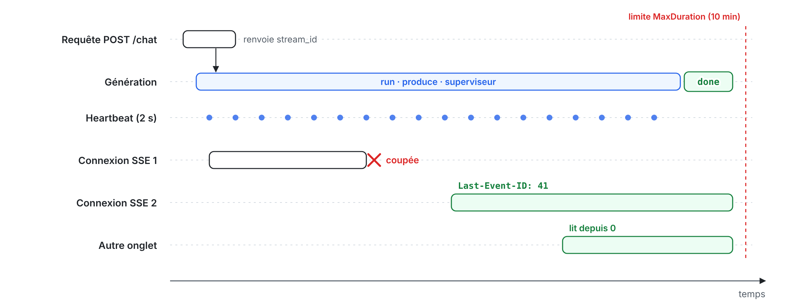
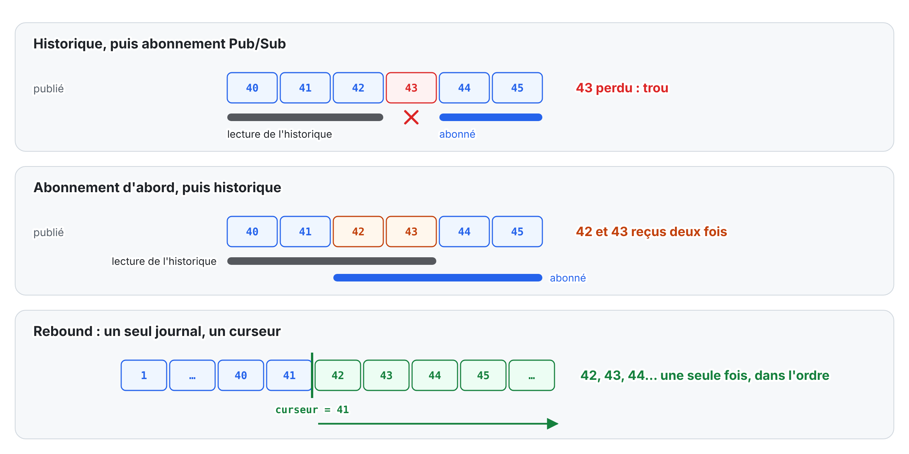
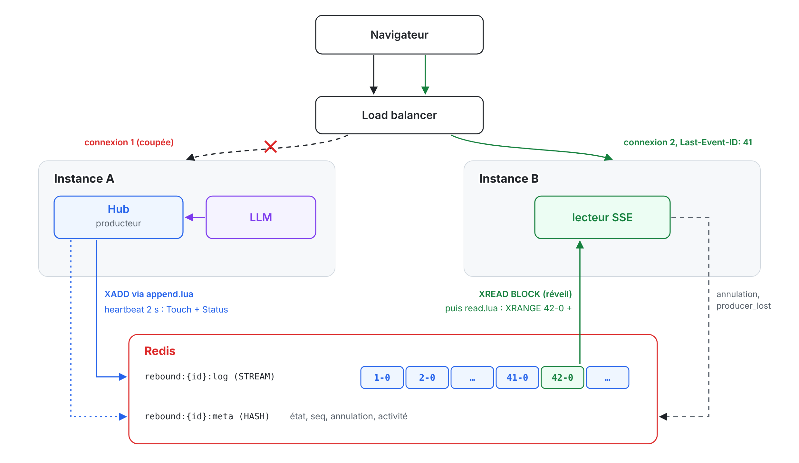

# Une réponse LLM ne devrait pas mourir avec la connexion HTTP

*Comment j’ai rendu les flux SSE reprenables en Go : une génération détachée de la requête, un seul journal numéroté, et des clients qui reprennent là où ils en étaient, sur n’importe quel serveur.*

*English version: [docs/how-it-works.md](../how-it-works.md)*

En développant des agents IA et des chatbots, j’ai souvent vu le même scénario : une réponse coupée en plein milieu n’avait qu’un remède, reposer la question. L’utilisateur attendait une deuxième fois, le modèle générait une deuxième réponse (pas forcément la même), et les tokens étaient payés deux fois.

Le modèle et le réseau faisaient leur travail. Le défaut était dans une hypothèse que presque tous les chats LLM font sans la voir : la réponse vit aussi longtemps que la connexion HTTP qui la transporte. C’est ce problème qui m’a poussé à écrire Rebound, une petite bibliothèque Go qui casse ce lien. Cet article explique le problème, l’approche, et ce que Go apporte ici, en particulier les goroutines et les contextes.

## Ce qui se passe quand la connexion tombe

La plupart des backends de chat font la même chose. Le handler reçoit la question, appelle le fournisseur LLM, et recopie les tokens dans la réponse SSE au fur et à mesure. En Go avec Gin, cela ressemble à ceci (version simplifiée) :

```go
func chat(c *gin.Context) {
    tokens := llm.Stream(c.Request.Context(), prompt) // lié à la requête
    for tok := range tokens {
        c.SSEvent("data", tok)
        c.Writer.Flush()
    }
}
```

Ce code marche tant que rien ne bouge. Mais un téléphone qui passe du Wi-Fi à la 4G, un onglet rechargé, un proxy qui ferme une connexion inactive ou un déploiement qui redémarre un pod, et la connexion disparaît. Il reste alors deux issues, toutes deux mauvaises :

- le contexte de la requête est annulé, l’appel au modèle s’arrête et la réponse partielle est perdue ;
- ou le serveur continue à générer dans une socket morte, et personne ne lit ce qu’on paie.

Dans les deux cas, impossible de reprendre. Avec plusieurs instances derrière un load balancer, c’est pire : la reconnexion arrive sur un serveur qui n’a jamais entendu parler de cette génération.


*Avant, la connexion est la seule copie de la réponse. Après, la réponse est écrite dans un journal, et la connexion n’est plus qu’un lecteur parmi d’autres, éventuellement sur une autre instance.*

## Pourquoi les solutions évidentes ne suffisent pas

Le premier réflexe est de compter sur `EventSource`. Le navigateur se reconnecte tout seul et renvoie l’en-tête `Last-Event-ID`. Mais il ne peut pas envoyer d’en-tête `Authorization`, il ne sait pas reprendre à un curseur choisi après un rechargement de page, et on contrôle mal ses tentatives. Surtout, l’en-tête ne sert à rien si le serveur n’a gardé aucun événement à rejouer.

Deuxième réflexe : relancer la requête. On régénère une réponse différente, on paie deux fois, et l’utilisateur voit le texte repartir de zéro. C’est le contournement que je voyais partout.

Passer aux WebSockets ne change rien non plus : une socket reste une connexion, pas un historique. Pour reprendre, il faut toujours un tampon côté serveur et un curseur.

Restait à voir ce qui existe déjà. En TypeScript, Vercel publie [`resumable-stream`](https://github.com/vercel/resumable-stream), basé sur le Pub/Sub de Redis et pensé pour les fonctions serverless. L’équipe de Stardrift a [décrit sa propre solution](https://stardrift.ai/blog/streaming-resumptions), avec Redis Streams et un backend FastAPI. En Go, `tmaxmax/go-sse` sait rejouer des événements, mais ses implémentations fournies les gardent en mémoire, et `r3labs/sse` rejoue un journal en mémoire, perdu au redémarrage. Je n’ai rien trouvé en Go qui gère à la fois un producteur détaché de la requête, plusieurs instances, l’annulation et une fin de flux garantie. D’où Rebound.

## L’idée : la connexion n’est plus la source de vérité

Rebound tient en une phrase : on démarre une génération une seule fois, elle écrit dans un journal numéroté, et chaque client lit ce journal à partir d’un numéro.

Quatre pièces font tourner ça :

1. **Le producteur** est votre fonction qui appelle le LLM. Il écrit des événements dans le journal et ne sait pas qui écoute.
2. **Le Hub** orchestre : il démarre les producteurs, applique les timeouts et les annulations, et écrit l’événement final de chaque flux.
3. **Le store** garde le journal et l’état du flux (en cours, terminé, en erreur). Rebound en fournit deux : en mémoire pour une seule instance, Redis pour plusieurs.
4. **Les lecteurs** sont les connexions SSE. Chacune lit les événements strictement après un numéro, celui que le client renvoie dans `Last-Event-ID`.

Chaque événement porte un numéro dense, 1, 2, 3…, qui devient le champ `id:` du message SSE. Le store le valide de façon atomique : une écriture répétée après une coupure réseau n’est jamais stockée deux fois. Quand un client revient avec `Last-Event-ID: 41`, il reçoit l’événement 42, puis la suite, qu’elle soit déjà écrite ou pas encore.

## Go : qui vit combien de temps

Dans le code naïf, tout tourne dans la goroutine de la requête HTTP : quand elle meurt, la génération meurt avec elle. Avec Rebound, `hub.Start` crée le flux dans le store, lance la génération dans des goroutines possédées par le Hub, et rend la main aussitôt avec l’identifiant du flux.

Le détail qui compte est le contexte. En Go, annuler le contexte d’une requête annule tout ce qui en dérive, donc le producteur ne doit pas hériter de `r.Context()` tel quel. Depuis Go 1.21, [`context.WithoutCancel`](https://pkg.go.dev/context#WithoutCancel) garde les valeurs du contexte parent sans son annulation. Rebound y ajoute `context.WithCancelCause`, pour annuler ce contexte en disant pourquoi :

```go
base := context.WithoutCancel(r.Context())    // la requête peut mourir
pctx, cancel := context.WithCancelCause(base) // la cause dira comment le flux finit
go hub.run(base, pctx, cancel, produce)       // simplifié : lance produce et un superviseur

// dans le superviseur :
//   timer MaxDuration (10 min) → cancel(errTimeout)
//   heartbeat (2 s)            → Touch + Status ; annulé ailleurs → cancel(ErrCancelled)
// Hub.Cancel sur cette instance → cancel(ErrCancelled), immédiatement
// Hub.Close à l'échéance        → cancel(errShutdown)
```

Pourquoi pas un simple `context.WithTimeout` ? Parce que la limite de durée passe par une horloge injectable, ce qui rend les tests déterministes, et parce que la cause d’annulation choisit l’événement final : `timeout`, `cancelled`, `server_shutdown` ou `max_events_exceeded`. Conséquence à connaître : `ctx.Deadline()` ne renvoie rien, donc votre SDK LLM ne voit pas d’échéance.

Chaque flux fait donc tourner trois goroutines côté producteur :

- `run` gère le cycle de vie et écrit l’événement final ;
- une goroutine exécute votre fonction `produce`, sous `recover` ;
- le superviseur porte le timer `MaxDuration` et le heartbeat, qui toutes les 2 secondes signale au store que le producteur vit et regarde si une autre instance a demandé l’annulation.

Côté lecture, chaque connexion SSE a sa goroutine de handler, qui écrit la réponse, et une goroutine `pump`, qui lit le journal à partir du curseur. Toutes deux meurent avec la connexion sans toucher au producteur. Le ping SSE (un commentaire `: ping` toutes les 15 secondes, pour que les proxys ne coupent pas une connexion silencieuse) n’est pas une goroutine : c’est un ticker dans la boucle du handler.


*La requête qui a lancé la génération se termine tout de suite. Les connexions de lecture vont et viennent. Seule la génération dure, bornée par MaxDuration ou une annulation, même si votre code ignore son contexte.*

Ce dernier point compte. Si `produce` ignore l’annulation, le Hub lui laisse 2 secondes de grâce, puis écrit la fin sans lui. Si `produce` panique, le Hub récupère la panique et ferme le flux avec `producer_panic` ; les goroutines que votre code lance lui-même restent à votre charge. Et si le processus entier meurt, le heartbeat s’arrête : un lecteur connecté qui ne voit plus rien bouger pendant 15 secondes, mesurées sur sa propre horloge, ferme le flux avec `producer_lost`. Sans lecteur, le flux expire simplement.

## Le piège : rejouer, puis s’abonner

La première idée qui vient pour le direct est Redis Pub/Sub : on garde un historique pour rejouer, et on publie les nouveaux tokens sur un canal. Le client qui revient lit l’historique, puis s’abonne au canal.

Le problème est entre les deux. Si un événement est publié après la fin de la lecture de l’historique mais avant que l’abonnement soit actif, il est perdu : c’est un trou. Si on s’abonne d’abord pour éviter ça, les événements publiés pendant la lecture de l’historique arrivent deux fois : ce sont des doublons. On peut s’en sortir avec de la déduplication et des précautions, et certaines bibliothèques le font à leur façon, mais chaque implémentation faite à la main redécouvre ces cas.


*Avec deux sources, il y a une jonction où se glissent trous et doublons. Avec un seul journal, rejouer et suivre le direct sont la même opération.*

Rebound supprime la jonction. Les lecteurs ne lisent que le journal, pour le passé comme pour le futur. Il n’y a pas de canal séparé. La boucle de lecture ressemble à ceci :

```go
cursor := lastEventID
for {
    evs, err := st.Read(ctx, id, cursor, 64, 5*time.Second) // passé ou futur : même appel
    if err != nil {
        return err
    }
    for _, ev := range evs {
        send(ev) // id: ev.Seq
        cursor = ev.Seq
        if ev.Kind == "done" || ev.Kind == "error" {
            return nil
        }
    }
    // rien depuis 5 s : vérifier que le producteur vit encore (producer_lost)
}
```

Que l’événement 42 ait été écrit il y a une minute ou qu’il arrive dans 100 ms, c’est le même appel. La garantie « ni trou ni doublon » découle de la structure : un numéro attribué atomiquement, un seul journal lu par curseur, et aucune jonction à synchroniser.

## Plusieurs serveurs : Redis

Avec Redis, chaque flux tient dans deux clés : `rebound:{id}:log`, un [Redis Stream](https://redis.io/docs/latest/develop/data-types/streams/) dont les entrées s’appellent simplement `<seq>-0`, et `rebound:{id}:meta`, un hash qui garde l’état, le dernier numéro, le drapeau d’annulation et la dernière activité. Le hash tag `{id}` place les deux clés sur le même slot, ce qui les rend compatibles avec Redis Cluster.

Toutes les opérations (création, écriture, lecture, statut, annulation, heartbeat) sont des scripts Lua, exécutés de façon atomique par Redis. Avant d’écrire, le script d’écriture vérifie que le flux est ouvert et non annulé, que le plafond d’événements n’est pas atteint, et que le numéro attendu est le bon, ou qu’il s’agit du rejeu exact d’une écriture déjà faite. Il attribue ensuite le numéro, ajoute l’entrée et rafraîchit l’expiration. Deux écritures ne peuvent pas obtenir le même numéro, même si elles viennent de deux serveurs.

La lecture passe aussi par un script : il vérifie que le flux existe, puis fait `XRANGE log 42-0 + COUNT 64` pour un lecteur dont le curseur vaut 41. Quand il n’y a rien de neuf, le lecteur attend avec `XREAD BLOCK` sur `41-0`, par tranches de 250 ms. Cet appel ne sert qu’à le réveiller : les événements sont ensuite relus par le script. Au plus la moitié du pool de connexions Redis attend ainsi, pour que les écritures trouvent toujours une connexion libre ; les autres lecteurs interrogent le store toutes les 250 ms.


*Le producteur reste sur l’instance A. Le client reconnecté arrive sur l’instance B, qui lit le même journal à partir de son curseur. Le hash meta relie les deux : c’est par lui qu’une annulation reçue par B atteint le producteur sur A.*

Le producteur ne bouge pas. C’est le lecteur qui peut atterrir n’importe où, puisqu’il ne dépend que du journal et de son curseur.

## Une seule fin, quoi qu’il arrive

Un flux se termine par un événement final, `done` ou `error`. Plusieurs acteurs peuvent vouloir l’écrire au même moment : le Hub quand le producteur a fini, quand un timeout tombe ou qu’une annulation arrive, ou un lecteur qui constate que le producteur a disparu. Si deux d’entre eux réussissent, un client peut recevoir deux fins, ou un `done` après un `error`.

La règle est donc qu’une écriture finale est conditionnelle : le script ne l’accepte que si le flux est encore en cours. Le premier gagne, les autres reçoivent `ErrClosed` et l’ignorent. Une fin passe même sur un flux annulé, les données non. Il existe exactement un événement final par flux, et tous les lecteurs voient le même. En mémoire, un mutex joue le même rôle.

## Annuler et protéger un flux

`POST /streams/{id}/cancel` renvoie `202` et peut être appelé plusieurs fois sans effet de bord. Sur l’instance qui héberge le producteur, l’annulation est immédiate ; depuis une autre instance, elle arrive au prochain heartbeat, sous 2 secondes.

Rebound n’authentifie personne lui-même. L’identifiant d’un flux est aléatoire (128 bits) et sert de capacité de lecture. Pour aller plus loin, `httpx.WithAuthorize` reçoit la requête et le statut du flux, y compris les métadonnées passées à `Start` avec `WithMeta`, et peut répondre `401` ou `403`, pour la lecture comme pour l’annulation.

## Comment Rebound a été testé

Le code a d’abord été couvert par des tests unitaires, tous lancés avec le détecteur de courses de Go (`-race`) et un seuil de couverture minimal par paquet. Les deux stores, mémoire et Redis, passent la même suite de tests de contrat, ce qui garantit qu’ils se comportent de la même façon.

Ces tests ne suffisent pas pour ce genre de code : les bugs apparaissent quand une connexion tombe au mauvais moment. J’ai donc écrit un testeur de conformité, un petit binaire Go qui se comporte comme un client hostile. Il démarre un flux au contenu connu, coupe la connexion au hasard après chaque événement (30 % du temps par défaut), se reconnecte avec `Last-Event-ID` après 0 à 200 ms, et compare, événement par événement, la séquence reçue à la séquence attendue : aucun trou, aucun doublon, une seule fin. Il couvre douze scénarios, dont l’annulation, un producteur qui échoue, plusieurs lecteurs simultanés sur un même flux et le client qui arrive après la fin. Une passe complète, c’est 200 exécutions du scénario principal et 20 de chacun des autres, soit environ 104 000 reconnexions. Elle passe sans échec en mémoire comme sur deux instances Redis derrière nginx. Tout le hasard dérive d’une seule graine, affichée au début de chaque exécution : un échec peut toujours être rejoué à l’identique.

Viennent ensuite les tests en conditions réelles, avec un vrai modèle : `openai/gpt-oss-20b` via l’API compatible OpenAI de Groq, Redis et deux instances derrière nginx. En rechargeant la page pendant de longues réponses, les logs montraient des reprises à des numéros comme 599 ou 1595, servies par l’une ou l’autre instance, sans erreur et sans texte manquant.

En chemin, trois problèmes sérieux sont apparus, tous corrigés avant la v0.1 :

- un producteur qui ignorait l’annulation pouvait rester bloqué indéfiniment. Le Hub lui laisse maintenant 2 secondes de grâce, puis écrit la fin sans lui ;
- reprendre après la suppression des plus anciens événements d’un journal ne pouvait jamais réussir. Rebound ne supprime donc plus rien : le nombre d’événements est plafonné, et le flux s’arrête proprement à la limite ;
- une coupure de Redis pouvait ressembler, côté lecteur, à une fin de flux normale. Elle est désormais remontée comme une erreur.

## L’utiliser

Rebound demande Go 1.26 ou plus. L’intégration se fait en deux temps : `POST /chat` démarre la génération et renvoie l’adresse du flux, puis le client lit `GET /streams/{id}` et y revient avec `Last-Event-ID` aussi souvent que nécessaire. Le README contient un exemple complet avec `net/http`. Voici le cœur de l’intégration avec Gin et Redis :

```go
rdb := goredis.NewClient(&goredis.Options{Addr: "localhost:6379", PoolSize: 256})
st, err := redisstore.New(rdb)
if err != nil {
    log.Fatal(err)
}
hub, err := rebound.New(st)
if err != nil {
    log.Fatal(err)
}
streams := httpx.NewHandler(hub)

r := gin.Default()
r.POST("/chat", func(c *gin.Context) {
    var req chatRequest
    if err := c.ShouldBindJSON(&req); err != nil {
        c.JSON(http.StatusBadRequest, gin.H{"error": "invalid_request"})
        return
    }
    s, err := hub.Start(c.Request.Context(), func(ctx context.Context, w rebound.Writer) error {
        return streamLLM(ctx, req.Prompt, func(tok string) error {
            return w.WriteJSON(gin.H{"text": tok})
        })
    })
    if err != nil {
        c.JSON(http.StatusServiceUnavailable, gin.H{"error": "unavailable"})
        return
    }
    c.JSON(http.StatusCreated, gin.H{"stream_id": s.ID, "url": "/streams/" + s.ID})
})
r.GET("/streams/:id", ginx.Stream(streams, "id"))
r.POST("/streams/:id/cancel", ginx.Cancel(streams, "id"))
```

`streamLLM` représente votre client LLM habituel : la seule différence est qu’il écrit dans `w` au lieu d’écrire dans la réponse HTTP.

Côté navigateur, le client TypeScript `@bailalayoub/rebound-client`, sans dépendance et basé sur `fetch`, apporte ce qu'`EventSource` ne fait pas : des en-têtes d’authentification, un curseur à restaurer après un rechargement, des reprises avec backoff exponentiel, l’arrêt propre sur `204`, `404` ou `410`, et jamais deux fois le même `id`.

```ts
import { subscribe } from "@bailalayoub/rebound-client";

const res = await fetch("/chat", {
  method: "POST",
  headers: { "Content-Type": "application/json" },
  body: JSON.stringify({ prompt: "Explique les goroutines" }),
});
const { url } = await res.json();

const sub = subscribe(url, {
  onEvent: (e) => { if (e.kind === "data") render(JSON.parse(e.data).text); },
  onDone: () => console.log("terminé"),
  onError: (err) => console.warn(err.code, err.fatal),
});
// sub.lastEventId : à sauvegarder pour reprendre après un rechargement
```

## Ce que Rebound ne fait pas (encore)

Si le processus qui héberge le producteur meurt, la génération n’est pas reprise : le flux se ferme avec `producer_lost`, et c’est à l’application d’en relancer une si elle le souhaite. Reprendre un appel LLM à mi-chemin sur une autre machine est un autre problème.

Les réglages par défaut ont aussi des conséquences à connaître :

- une génération dure au plus 10 minutes, puis se termine en `timeout`. Une longue réponse de raisonnement peut atteindre cette limite ; `WithStreamMaxDuration` la change pour un flux ;
- un flux compte au plus 10 000 événements. Au-delà, il s’arrête avec `max_events_exceeded`, mais rien n’est jamais tronqué : on peut toujours le relire depuis 0 ;
- un flux terminé reste lisible 10 minutes. Un client qui revient après reçoit un `404` : la réponse n’existe plus côté serveur ;
- un événement fait au plus 64 Kio. Le texte est normalisé en UTF-8 avec des fins de ligne LF ; le binaire passe en base64 dans du JSON.

Côté Redis, la mémoire grandit avec le nombre de flux gardés, multiplié par leurs événements et la taille de chacun ; la documentation du store donne la formule. Redis Cluster et Sentinel sont pris en charge grâce aux hash tags, mais n’ont été testés que sur un seul nœud, sans basculement réel. Un Redis sans persistance qui redémarre perd les flux en cours, et les clients reçoivent un `404`. Redis 6.2 est la version minimale.

La spécification est dans [docs/02-spec.md](../02-spec.md) et le testeur de conformité dans [docs/06-conformance.md](../06-conformance.md). Le testeur fonctionne contre n’importe quel serveur qui implémente le même contrat HTTP et un petit endpoint de démarrage de test. Si vous avez votre propre implémentation, en Go ou dans un autre langage, faites-la passer dedans et ouvrez une issue avec le résultat.
