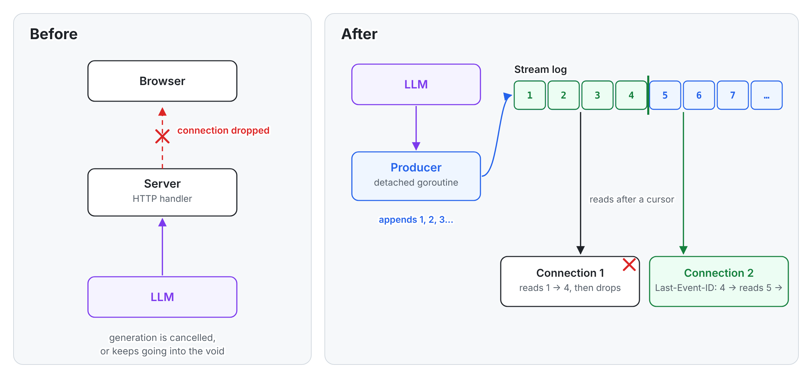
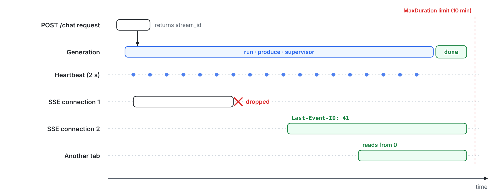
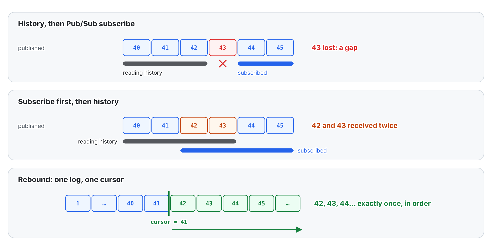
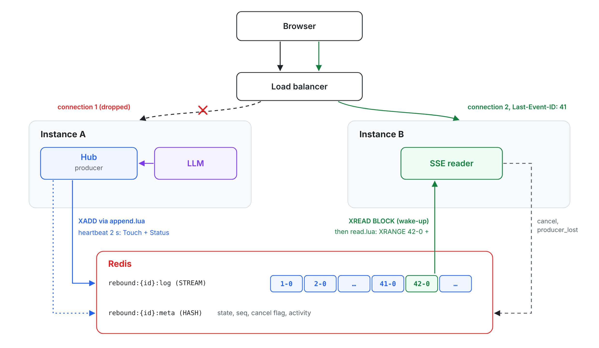

# Your LLM answer shouldn’t die with the HTTP connection

*How I made SSE streams resumable in Go: a generation detached from the request, one numbered log, and clients that pick up where they left off, on any server.*

*Version française : [docs/fr/comment-ca-marche.md](fr/comment-ca-marche.md)*

Building AI agents and chatbots, I kept running into the same scene: an answer cut off halfway had only one fix, asking the question again. The user waited a second time, the model generated a second answer (not necessarily the same one), and the tokens were paid for twice.

The model was fine and so was the network. The flaw was an assumption almost every LLM chat makes without noticing: an answer lives exactly as long as the HTTP connection carrying it. That problem is what pushed me to write Rebound, a small Go library that breaks the link. This post walks through the problem, the approach, and what Go brings to it, goroutines and contexts in particular.

## What happens when the connection drops

Most chat backends do the same thing. The handler receives the question, calls the LLM provider, and copies tokens into the SSE response as they arrive. In Go with Gin it looks roughly like this (simplified):

```go
func chat(c *gin.Context) {
    tokens := llm.Stream(c.Request.Context(), prompt) // tied to the request
    for tok := range tokens {
        c.SSEvent("data", tok)
        c.Writer.Flush()
    }
}
```

That works as long as nothing moves. Then a phone switches from Wi-Fi to 4G, a tab is reloaded, a proxy closes an idle connection, or a deploy restarts a pod, and the connection is gone. You are left with two bad outcomes:

- the request context is cancelled, the model call stops, and the partial answer is lost;
- or the server keeps generating into a dead socket, and you pay for tokens nobody reads.

Either way, there is nothing to resume. With several instances behind a load balancer it gets worse: the reconnection lands on a server that has never heard of this generation.


*Before, the connection is the only copy of the answer. After, the answer is written to a log, and the connection is just one reader among others, possibly on another instance.*

## Why the obvious fixes fall short

The first instinct is to rely on `EventSource`. The browser reconnects on its own and sends a `Last-Event-ID` header. But it can’t send an `Authorization` header, it can’t resume from a cursor you choose after a page reload, and you get little control over its retries. Most importantly, the header is useless if the server kept nothing to replay.

The second instinct is to retry the request. You get a different answer, you pay twice, and the user watches the text restart from zero. That’s the workaround I kept seeing everywhere.

Switching to WebSockets doesn’t help either: a socket is still a connection, not a history. Resuming still needs a server-side buffer and a cursor.

So I looked at what already exists. In TypeScript, Vercel ships [`resumable-stream`](https://github.com/vercel/resumable-stream), built on Redis Pub/Sub and designed for serverless functions. The Stardrift team [wrote up their own approach](https://stardrift.ai/blog/streaming-resumptions), with Redis Streams and a FastAPI backend. In Go, `tmaxmax/go-sse` can replay events, but its built-in replayers keep them in memory, and `r3labs/sse` replays an in-memory log that is lost on restart. I couldn’t find anything in Go that handles a producer detached from the request, multiple instances, cancellation and a guaranteed end of stream all together. Hence Rebound.

## The idea: the connection is no longer the source of truth

Rebound fits in one sentence: start a generation once, have it write to a numbered log, and let every client read that log from a number.

Four pieces make that work:

1. **The producer** is your function that calls the LLM. It writes events to the log and has no idea who is listening.
2. **The Hub** orchestrates: it starts producers, enforces timeouts and cancellations, and writes each stream’s final event.
3. **The store** keeps the log and the stream’s state (running, done, failed). Rebound ships two: in-memory for a single instance, Redis for several.
4. **Readers** are the SSE connections. Each one reads the events strictly after a number, the one the client sends back in `Last-Event-ID`.

Every event carries a dense number, 1, 2, 3…, which becomes the `id:` field of the SSE message. The store checks it atomically, so a write retried after a network blip is never stored twice. When a client comes back with `Last-Event-ID: 41`, it receives event 42 and everything after it, whether it was written a minute ago or hasn’t been written yet.

## Go: who lives how long

In the naive code, everything runs in the request’s goroutine, so when the request dies, the generation dies with it. With Rebound, `hub.Start` creates the stream in the store, runs the generation in goroutines owned by the Hub, and returns right away with the stream id.

The detail that matters is the context. In Go, cancelling a request’s context cancels everything derived from it, so the producer must not inherit `r.Context()` as is. Since Go 1.21, [`context.WithoutCancel`](https://pkg.go.dev/context#WithoutCancel) keeps the parent’s values but drops its cancellation. Rebound adds `context.WithCancelCause` on top, so it can cancel that context and say why:

```go
base := context.WithoutCancel(r.Context())    // the request may die
pctx, cancel := context.WithCancelCause(base) // the cause decides how the stream ends
go hub.run(base, pctx, cancel, produce)       // simplified: starts produce and a supervisor

// in the supervisor:
//   MaxDuration timer (10 min) → cancel(errTimeout)
//   heartbeat (2 s)            → Touch + Status; cancelled elsewhere → cancel(ErrCancelled)
// Hub.Cancel on this instance  → cancel(ErrCancelled), immediately
// Hub.Close at its deadline    → cancel(errShutdown)
```

Why not a plain `context.WithTimeout`? Because the time limit goes through an injectable clock, which keeps the tests deterministic, and because the cancellation cause picks the final event: `timeout`, `cancelled`, `server_shutdown` or `max_events_exceeded`. One consequence worth knowing: `ctx.Deadline()` returns nothing, so your LLM SDK sees no deadline.

So each stream runs three goroutines on the producer side:

- `run` manages the lifecycle and writes the final event;
- one goroutine runs your `produce` function, under `recover`;
- the supervisor holds the `MaxDuration` timer and the heartbeat, which every 2 seconds tells the store the producer is alive and checks whether another instance asked to cancel.

On the reading side, each SSE connection has its handler goroutine, which writes the response, and a `pump` goroutine, which reads the log from the cursor. Both die with the connection without touching the producer. The SSE ping (a `: ping` comment every 15 seconds, so proxies don’t close a quiet connection) isn’t a goroutine: it’s a ticker in the handler’s loop.


*The request that started the generation returns right away. Reader connections come and go. Only the generation lasts, bounded by MaxDuration or a cancel, even if your code ignores its context.*

That last point matters. If `produce` ignores cancellation, the Hub gives it 2 seconds of grace, then writes the end without it. If `produce` panics, the Hub recovers and closes the stream with `producer_panic`; goroutines your own code starts are still your responsibility. And if the whole process dies, the heartbeat stops: a connected reader that sees nothing move for 15 seconds, measured on its own clock, closes the stream with `producer_lost`. With no reader at all, the stream simply expires.

## The trap: replay, then subscribe

The usual first idea for live delivery is Redis Pub/Sub: keep a history for replay, publish new tokens on a channel. A returning client reads the history, then subscribes.

The problem sits between those two steps. If an event is published after the history read finishes but before the subscription is active, it’s lost: a gap. Subscribe first to avoid that, and events published during the history read arrive twice: duplicates. You can work around it with deduplication and care, and some libraries handle it in their own way, but every hand-rolled implementation rediscovers these cases.


*With two sources there is a seam where gaps and duplicates slip in. With one log, replaying and following live are the same operation.*

Rebound removes the seam. Readers only ever read the log, for the past and the future alike. There is no separate channel. The read loop looks like this:

```go
cursor := lastEventID
for {
    evs, err := st.Read(ctx, id, cursor, 64, 5*time.Second) // past or future: same call
    if err != nil {
        return err
    }
    for _, ev := range evs {
        send(ev) // id: ev.Seq
        cursor = ev.Seq
        if ev.Kind == "done" || ev.Kind == "error" {
            return nil
        }
    }
    // nothing for 5 s: check the producer is still alive (producer_lost)
}
```

Whether event 42 was written a minute ago or arrives in 100 ms, it’s the same call. "No gap, no duplicate" follows from the structure: a number assigned atomically, one log read by cursor, and no seam to synchronize.

## Several servers: Redis

With Redis, each stream lives in two keys: `rebound:{id}:log`, a [Redis Stream](https://redis.io/docs/latest/develop/data-types/streams/) whose entries are simply named `<seq>-0`, and `rebound:{id}:meta`, a hash holding the state, the last number, the cancel flag and the last activity. The `{id}` hash tag puts both keys on the same slot, which keeps them compatible with Redis Cluster.

Every operation (create, append, read, status, cancel, heartbeat) is a Lua script that Redis runs atomically. Before writing, the append script checks that the stream is open and not cancelled, that the event cap isn’t reached, and that the expected number is the right one, or that this is the exact replay of a write that already happened. Then it assigns the number, adds the entry and refreshes the expiry. Two writes can’t get the same number, even from two different servers.

Reads go through a script too: it checks the stream exists, then runs `XRANGE log 42-0 + COUNT 64` for a reader whose cursor is 41. When there’s nothing new, the reader waits with `XREAD BLOCK` on `41-0`, in 250 ms slices. That call only wakes the reader up; the events are then read again through the script. At most half of the Redis connection pool waits this way, so writes always find a free connection; the other readers poll the store every 250 ms.


*The producer stays on instance A. The reconnecting client lands on instance B, which reads the same log from its cursor. The meta hash ties them together: it’s how a cancel received by B reaches the producer on A.*

The producer never moves. The reader can land anywhere, because all it needs is the log and its cursor.

## Exactly one ending

A stream ends with a final event, `done` or `error`. Several actors may try to write it at the same moment: the Hub when the producer finishes, when a timeout fires or a cancel arrives, or a reader that noticed the producer disappeared. If two of them succeed, a client might get two endings, or a `done` after an `error`.

So a final write is conditional: the script accepts it only while the stream is still running. The first one wins, the others get `ErrClosed` and ignore it. An ending goes through even on a cancelled stream; data doesn’t. There is exactly one final event per stream, and every reader sees the same one. In memory, a mutex plays the same role.

## Cancelling and protecting a stream

`POST /streams/{id}/cancel` returns `202` and is safe to call more than once. On the instance hosting the producer, cancellation is immediate; from another instance, it lands on the next heartbeat, within 2 seconds.

Rebound doesn’t authenticate anyone by itself. A stream id is random (128 bits) and acts as a read capability. For more, `httpx.WithAuthorize` gets the request and the stream’s status, including the metadata passed to `Start` with `WithMeta`, and can answer `401` or `403`, for reading as well as cancelling.

## How Rebound was tested

The code was first covered by unit tests, all run with Go’s race detector (`-race`) and a minimum coverage threshold per package. Both stores, in-memory and Redis, pass the same contract test suite, which guarantees they behave the same way.

Those tests aren’t enough for this kind of code, because the bugs show up when a connection drops at the wrong moment. So I wrote a conformance tester, a small Go binary that behaves like a hostile client. It starts a stream with known content, drops the connection at random after each event (30% of the time by default), reconnects with `Last-Event-ID` after 0 to 200 ms, and compares the received sequence with the expected one, event by event: no gap, no duplicate, exactly one ending. It covers twelve scenarios, including cancellation, a failing producer, several concurrent readers on one stream, and a client that shows up after the end. A full pass is 200 runs of the core scenario and 20 of each of the others, about 104,000 reconnections. It passes with zero failures in memory and on two Redis-backed instances behind nginx. All the randomness comes from one seed, printed at the start of every run, so any failure can be replayed exactly.

Then came real-world tests with a real model: `openai/gpt-oss-20b` through Groq’s OpenAI-compatible API, with Redis and two instances behind nginx. Reloading the page during long answers, the logs showed resumes at numbers like 599 or 1595, served by one instance or the other, with no errors and no missing text.

Along the way, three serious problems came up, all fixed before v0.1:

- a producer that ignored cancellation could hang forever. The Hub now gives it 2 seconds of grace, then writes the end without it;
- resuming after the oldest events of a log had been dropped could never succeed. So Rebound no longer drops anything: the event count is capped, and the stream stops cleanly at the limit;
- a Redis outage could look, from the reader’s side, like a normal end of stream. It is now reported as an error.

## Using it

Rebound needs Go 1.26 or later. Integration happens in two steps: `POST /chat` starts the generation and returns the stream’s URL, then the client reads `GET /streams/{id}` and comes back to it with `Last-Event-ID` as often as needed. The README has a complete `net/http` example. Here is the core of it with Gin and Redis:

```go
rdb := goredis.NewClient(&goredis.Options{Addr: "localhost:6379", PoolSize: 256})
st, err := redisstore.New(rdb)
if err != nil {
    log.Fatal(err)
}
hub, err := rebound.New(st)
if err != nil {
    log.Fatal(err)
}
streams := httpx.NewHandler(hub)

r := gin.Default()
r.POST("/chat", func(c *gin.Context) {
    var req chatRequest
    if err := c.ShouldBindJSON(&req); err != nil {
        c.JSON(http.StatusBadRequest, gin.H{"error": "invalid_request"})
        return
    }
    s, err := hub.Start(c.Request.Context(), func(ctx context.Context, w rebound.Writer) error {
        return streamLLM(ctx, req.Prompt, func(tok string) error {
            return w.WriteJSON(gin.H{"text": tok})
        })
    })
    if err != nil {
        c.JSON(http.StatusServiceUnavailable, gin.H{"error": "unavailable"})
        return
    }
    c.JSON(http.StatusCreated, gin.H{"stream_id": s.ID, "url": "/streams/" + s.ID})
})
r.GET("/streams/:id", ginx.Stream(streams, "id"))
r.POST("/streams/:id/cancel", ginx.Cancel(streams, "id"))
```

`streamLLM` stands for whatever LLM client you already use; the only change is that it writes to `w` instead of the HTTP response.

In the browser, the dependency-free TypeScript client `@bailalayoub/rebound-client`, built on `fetch`, adds what `EventSource` lacks: authentication headers, a cursor you can restore after a reload, retries with exponential backoff, a clean stop on `204`, `404` or `410`, and never the same `id` twice.

```ts
import { subscribe } from "@bailalayoub/rebound-client";

const res = await fetch("/chat", {
  method: "POST",
  headers: { "Content-Type": "application/json" },
  body: JSON.stringify({ prompt: "Explain goroutines" }),
});
const { url } = await res.json();

const sub = subscribe(url, {
  onEvent: (e) => { if (e.kind === "data") render(JSON.parse(e.data).text); },
  onDone: () => console.log("done"),
  onError: (err) => console.warn(err.code, err.fatal),
});
// sub.lastEventId: save it to resume after a reload
```

## What Rebound doesn’t do (yet)

If the process hosting the producer dies, the generation isn’t resumed: the stream closes with `producer_lost`, and it’s up to the application to start a new one if it wants. Resuming an LLM call halfway through on another machine is a different problem.

The defaults also have consequences worth knowing:

- a generation lasts at most 10 minutes, then ends with `timeout`. A long reasoning answer can hit that limit; `WithStreamMaxDuration` changes it per stream;
- a stream holds at most 10,000 events. Past that it stops with `max_events_exceeded`, but nothing is ever trimmed, so it can always be replayed from 0;
- a finished stream stays readable for 10 minutes. A client that comes back later gets a `404`: the answer no longer exists on the server;
- an event is at most 64 KiB. Text is normalized to UTF-8 with LF line endings; binary data goes as base64 inside JSON.

On the Redis side, memory grows with the number of retained streams times their events and the size of each; the store’s documentation gives the formula. Redis Cluster and Sentinel are supported thanks to hash tags, but have only been tested on a single node, with no real failover. A Redis without persistence that restarts loses in-flight streams, and clients get a `404`. Redis 6.2 is the minimum version.

The spec is in [docs/02-spec.md](02-spec.md) and the conformance tester in [docs/06-conformance.md](06-conformance.md). The tester runs against any server that implements the same HTTP contract plus a small test-start endpoint. If you have your own implementation, in Go or anything else, point it there and open an issue with the result.
